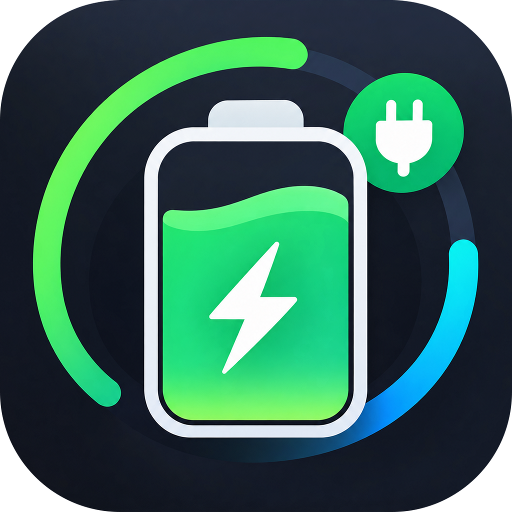

<p align="center">
  
</p>

<h1 align="center">MacCharge</h1>

<p align="center">
  macOS 用のバッテリー・充電器・電力・温度モニター —— リアルタイムのワット数をメニューバーに表示します。
</p>

<p align="center">
  <a href="README.md">English</a> · <a href="README.vi.md">Tiếng Việt</a> · <a href="README.zh-CN.md">简体中文</a> · <b>日本語</b>
</p>

---

## 機能

- **メニューバーと Dock アイコンにワット数をリアルタイム表示** —— 先頭の `›` はバッテリー駆動中を示します。
- **概要** —— 充電残量、充電状態、フル充電までの時間 / 残り使用時間。
- **バッテリーの状態** —— 充放電回数、設計容量と満充電容量、劣化度、温度、電圧。
- **充電器** —— 接続中の電源アダプタのワット数、電圧、電流。
- **電力** —— SMC の電源レールから読み取るシステム消費電力、バッテリーへの入出力電力、推移グラフ。
- **システム** —— CPU/GPU 温度、ファン回転数、CPU・メモリ・エネルギー使用量の多いアプリ。
- **冷却** —— ファンを自動/手動で切り替え、スライダーで目標回転数を設定。温度による安全カットオフ付き。
- **FolderTree** —— Mac 全体、ホームフォルダ、または選択（ドロップ）した任意のフォルダをスキャンし、容量を多く使っているフォルダを表示。項目をクリックすると Finder で表示・情報を見る・パスをコピー・ゴミ箱に入れるが選べます。ゴミ箱は専用タブで、空にすることもできます。
- **バックグラウンドで静かに動作** —— ウィンドウを閉じてもメニューバー項目だけが残ります。ログイン時の自動起動もワンタップ。
- ユニバーサルバイナリ（Apple Silicon + Intel）、ネイティブ SwiftUI、外部依存なし。

## 動作環境

- macOS 14 Sonoma 以降
- Apple Silicon または Intel 搭載の Mac

## インストール

1. [Releases](../../releases/latest) から `MacCharge-x.y.z.dmg` をダウンロードします。
2. DMG を開き、**MacCharge** を **アプリケーション** フォルダへドラッグします。
3. アプリは Developer ID で署名済みですが、まだ公証されていません。初回起動がブロックされた場合は、アプリを右クリック → **開く**、または **システム設定 → プライバシーとセキュリティ** で **このまま開く** をクリックしてください。

## ファン制御

SMC は root からのファン命令しか受け付けません。冷却タブのスライダーを初めて使うとき、MacCharge は管理者パスワードを一度だけ求め、
`/Library/Application Support/MacCharge/maccharge-fanhelper` に小さなヘルパーをインストールします。ヘルパーは冷却タブからいつでも削除できます。

安全ルール：

- 0% は各ファンのファームウェア最低回転数です —— ソフトウェアからファンを停止させることはありません。
- いずれかのセンサーが **92 °C** に達すると、ファン制御は自動的に macOS に戻ります（100% に設定している場合を除く）。
- MacCharge を終了するとファンは自動モードに戻ります。

## ソースからビルド

Xcode 15 以降（Swift 5.9）が必要です。

```bash
git clone <リポジトリURL> MacCharge
cd MacCharge
./build_app.sh            # ユニバーサル版 MacCharge.app
./build_app.sh --native   # 高速、この Mac のアーキテクチャのみ
./make_dmg.sh             # dist/ にドラッグ＆ドロップ用 DMG を作成
```

キーチェーンに "Developer ID Application" 証明書があれば `build_app.sh` はそれで署名し、なければアドホック署名になります。`notarytool` のキーチェーンプロファイルを設定済みなら、`make_dmg.sh` は公証まで行います（スクリプト冒頭のコメントを参照）。

## プロジェクト構成

| パス | 内容 |
| --- | --- |
| `Sources/MacCharge` | SwiftUI アプリ：モニター、メニューバー/Dock 表示、ビュー |
| `Sources/SMCCore` | アプリとヘルパーで共有する SMC アクセス |
| `Sources/MacChargeFanHelper` | root 権限でファン回転数を書き込むヘルパー |
| `Resources` | アプリアイコン |

## お問い合わせ

ご質問・不具合報告・ご提案は issue を作成するか、**gettesterinfo@gmail.com** までメールしてください。

## ライセンス

[MIT](LICENSE) © 2026 YuhTahn
