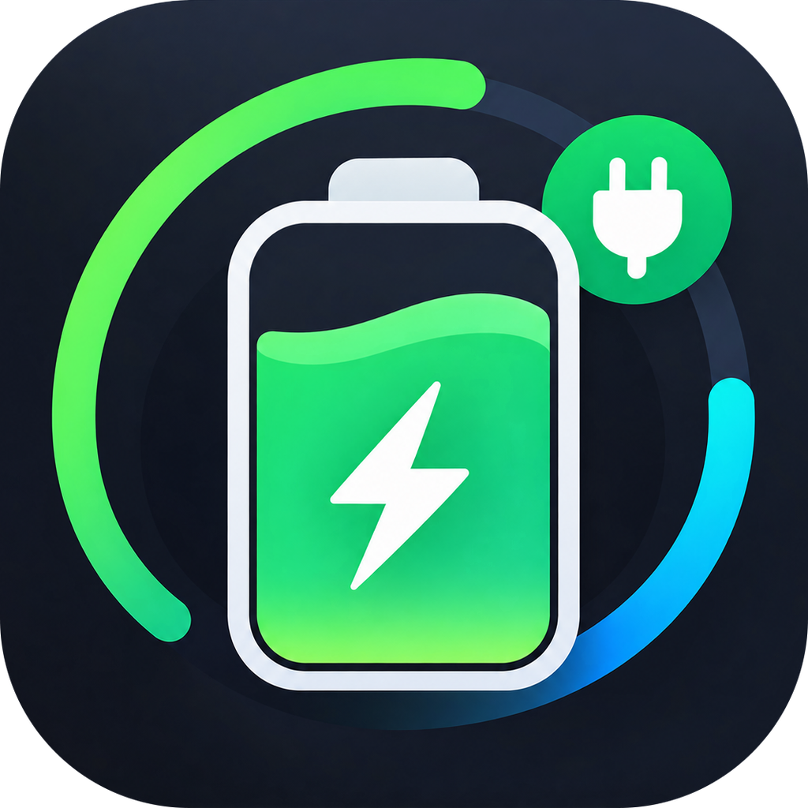

<p align="center">
  
</p>

<h1 align="center">MacCharge</h1>

<p align="center">
  Battery, charger, power and thermal monitor for macOS — live wattage right in your menu bar.
</p>

<p align="center">
  <b>English</b> · <a href="README.vi.md">Tiếng Việt</a> · <a href="README.zh-CN.md">简体中文</a> · <a href="README.ja.md">日本語</a>
</p>

---

## Features

- **Live wattage in the menu bar and on the Dock icon** — a leading `›` means the Mac is running on battery.
- **Overview** — charge level, charging state, time to full / time to empty.
- **Battery health** — cycle count, design vs. full-charge capacity, wear, temperature, voltage.
- **Charger** — connected adapter's wattage, voltage and current.
- **Power** — live system power draw (from the SMC power rails), power into/out of the battery, and a rolling chart.
- **System** — CPU/GPU temperatures, fan speeds, and the top apps by CPU, memory and energy use.
- **Cooling** — switch fans between Auto and Manual and set the target speed with a slider, with a built-in temperature safety cutoff.
- **Runs quietly in the background** — closing the window keeps only the menu-bar item; launch at login is one toggle away.
- Universal binary (Apple Silicon + Intel), native SwiftUI, no dependencies.

## Requirements

- macOS 14 Sonoma or later
- Apple Silicon or Intel Mac

## Install

1. Download `MacCharge-x.y.z.dmg` from [Releases](../../releases/latest).
2. Open the DMG and drag **MacCharge** into **Applications**.
3. The app is signed with a Developer ID but not yet notarized. If macOS blocks the first launch, right-click the app → **Open**, or open **System Settings → Privacy & Security** and click **Open Anyway**.

## Fan control

The SMC only accepts fan commands from root. The first time you use the Cooling slider, MacCharge asks for your admin password once and installs a small helper at
`/Library/Application Support/MacCharge/maccharge-fanhelper`. You can remove it any time from the Cooling tab.

Safety rules:

- 0% means each fan's firmware minimum — fans are never stopped from software.
- If any sensor reaches **92 °C**, the fans are handed back to macOS automatically (unless you have set 100%).
- Fans return to automatic when MacCharge quits.

## Build from source

Requires Xcode 15+ (Swift 5.9).

```bash
git clone <this-repo-url> MacCharge
cd MacCharge
./build_app.sh            # universal MacCharge.app
./build_app.sh --native   # faster, this Mac's architecture only
./make_dmg.sh             # drag-to-Applications DMG in dist/
```

`build_app.sh` signs with your "Developer ID Application" certificate if one is in the keychain, and falls back to ad-hoc signing otherwise. `make_dmg.sh` also notarizes when a `notarytool` keychain profile is set up (see the comments at the top of the script).

## Project layout

| Path | What it is |
| --- | --- |
| `Sources/MacCharge` | The SwiftUI app: monitors, menu-bar/Dock presenter, views |
| `Sources/SMCCore` | SMC access shared by the app and the helper |
| `Sources/MacChargeFanHelper` | Root helper that writes fan speeds |
| `Resources` | App icon |

## Contact

Questions, bugs or ideas: open an issue or email **gettesterinfo@gmail.com**.

## License

[MIT](LICENSE) © 2026 YuhTahn
