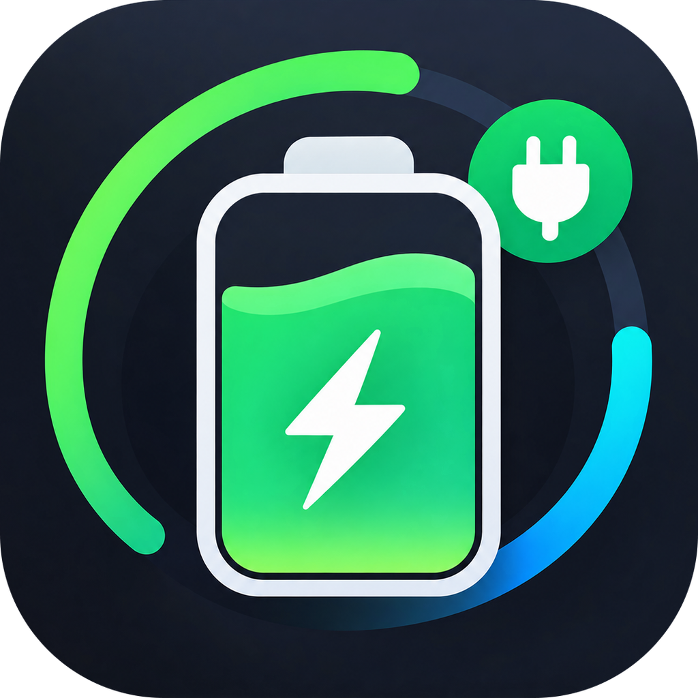

<p align="center">
  
</p>

<h1 align="center">MacCharge</h1>

<p align="center">
  Theo dõi pin, bộ sạc, công suất và nhiệt độ cho macOS — số watt hiện ngay trên thanh menu.
</p>

<p align="center">
  <a href="README.md">English</a> · <b>Tiếng Việt</b> · <a href="README.zh-CN.md">简体中文</a> · <a href="README.ja.md">日本語</a>
</p>

---

## Tính năng

- **Số watt trực tiếp trên thanh menu và trên icon Dock** — dấu `›` phía trước nghĩa là máy đang chạy bằng pin.
- **Tổng quan** — phần trăm pin, trạng thái sạc, thời gian sạc đầy / thời gian còn lại.
- **Sức khỏe pin** — số chu kỳ sạc, dung lượng thiết kế so với dung lượng thực tế, độ chai, nhiệt độ, điện áp.
- **Bộ sạc** — công suất, điện áp và dòng điện của adapter đang cắm.
- **Công suất** — công suất tiêu thụ thực của hệ thống (đọc từ SMC), công suất vào/ra pin, kèm biểu đồ theo thời gian thực.
- **Hệ thống** — nhiệt độ CPU/GPU, tốc độ quạt, và các app ngốn CPU, RAM, năng lượng nhiều nhất.
- **Làm mát** — chuyển quạt giữa Tự động và Thủ công, kéo thanh trượt để chỉnh tốc độ, có ngưỡng nhiệt an toàn.
- **Chạy nền gọn nhẹ** — đóng cửa sổ thì chỉ còn số watt trên thanh menu; bật khởi động cùng máy chỉ bằng một nút.
- Universal binary (Apple Silicon + Intel), SwiftUI thuần, không phụ thuộc thư viện ngoài.

## Yêu cầu

- macOS 14 Sonoma trở lên
- Mac Apple Silicon hoặc Intel

## Cài đặt

1. Tải `MacCharge-x.y.z.dmg` ở mục [Releases](../../releases/latest).
2. Mở file DMG và kéo **MacCharge** vào **Applications**.
3. App đã ký Developer ID nhưng chưa notarize. Nếu macOS chặn lần mở đầu, chuột phải vào app → **Open**, hoặc vào **System Settings → Privacy & Security** và bấm **Open Anyway**.

## Điều khiển quạt

SMC chỉ nhận lệnh quạt từ root. Lần đầu dùng thanh trượt ở tab Làm mát, MacCharge sẽ hỏi mật khẩu admin một lần và cài một helper nhỏ tại
`/Library/Application Support/MacCharge/maccharge-fanhelper`. Có thể gỡ helper bất cứ lúc nào ngay trong tab Làm mát.

Quy tắc an toàn:

- 0% là tốc độ tối thiểu của firmware — phần mềm không bao giờ tắt hẳn quạt.
- Nếu bất kỳ cảm biến nào chạm **92 °C**, quạt tự trả về cho macOS điều khiển (trừ khi đang đặt 100%).
- Thoát MacCharge thì quạt trở về chế độ tự động.

## Build từ mã nguồn

Cần Xcode 15+ (Swift 5.9).

```bash
git clone <url-của-repo> MacCharge
cd MacCharge
./build_app.sh            # MacCharge.app universal
./build_app.sh --native   # nhanh hơn, chỉ build cho kiến trúc của máy này
./make_dmg.sh             # tạo DMG kéo-thả vào Applications trong dist/
```

`build_app.sh` ký bằng chứng chỉ "Developer ID Application" nếu có trong keychain, không có thì ký ad-hoc. `make_dmg.sh` sẽ notarize luôn nếu đã cấu hình keychain profile cho `notarytool` (xem chú thích đầu script).

## Cấu trúc dự án

| Đường dẫn | Nội dung |
| --- | --- |
| `Sources/MacCharge` | App SwiftUI: bộ đọc dữ liệu, thanh menu/Dock, giao diện |
| `Sources/SMCCore` | Truy cập SMC, dùng chung cho app và helper |
| `Sources/MacChargeFanHelper` | Helper chạy quyền root để ghi tốc độ quạt |
| `Resources` | Icon app |

## Liên hệ

Câu hỏi, báo lỗi hay góp ý: mở issue hoặc gửi email tới **gettesterinfo@gmail.com**.

## Giấy phép

[MIT](LICENSE) © 2026 YuhTahn
