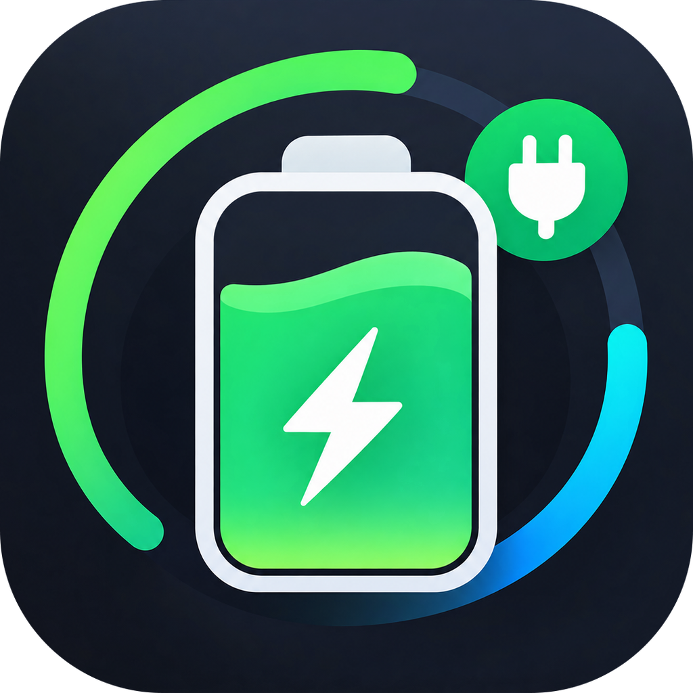

<p align="center">
  
</p>

<h1 align="center">MacCharge</h1>

<p align="center">
  macOS 电池、充电器、功耗与温度监测工具 —— 实时功率直接显示在菜单栏。
</p>

<p align="center">
  <a href="README.md">English</a> · <a href="README.vi.md">Tiếng Việt</a> · <b>简体中文</b> · <a href="README.ja.md">日本語</a>
</p>

---

## 功能

- **菜单栏与 Dock 图标实时显示功率** —— 前面带 `›` 表示 Mac 正在使用电池供电。
- **概览** —— 电量、充电状态、充满所需时间 / 剩余使用时间。
- **电池健康** —— 循环次数、设计容量与实际满充容量、损耗、温度、电压。
- **充电器** —— 已连接电源适配器的功率、电压与电流。
- **功耗** —— 系统实时功耗（来自 SMC 电源轨）、电池充放电功率，以及滚动曲线图。
- **系统** —— CPU/GPU 温度、风扇转速，以及占用 CPU、内存、能耗最多的应用。
- **散热** —— 风扇可在自动与手动之间切换，用滑块设定目标转速，内置温度安全阈值。
- **FolderTree** —— 扫描整台 Mac、个人文件夹或任意选择（或拖入）的文件夹，扫描过程中即可看到各文件夹的大小逐步显示。左键展开文件夹，右键可在 Finder 中显示、显示简介、快速查看、拷贝路径、在终端中打开或移到废纸篓。支持按名称筛选、多选（⌘/⇧ 点按、方向键、⌘A）、按类型或最近打开时间列出最大的文件、按占父文件夹的比例着色、环形图，并显示其余磁盘空间的去向（VM、Preboot、Recovery 等）。废纸篓有独立的标签页，可一键清倒。
- **安静地在后台运行** —— 关闭窗口后只保留菜单栏项目；开机自动启动只需一个开关。
- 通用二进制（Apple Silicon + Intel），原生 SwiftUI，无第三方依赖。

## 系统要求

- macOS 14 Sonoma 或更高版本
- Apple Silicon 或 Intel Mac

## 安装

1. 从 [Releases](../../releases/latest) 下载 `MacCharge-x.y.z.dmg`。
2. 打开 DMG，将 **MacCharge** 拖入 **应用程序**。
3. 应用已使用 Developer ID 签名，但尚未公证。若 macOS 阻止首次打开，请右键点击应用 → **打开**，或前往 **系统设置 → 隐私与安全性** 点击 **仍要打开**。

## 风扇控制

SMC 只接受来自 root 的风扇指令。首次使用散热页的滑块时，MacCharge 会请求一次管理员密码，并在
`/Library/Application Support/MacCharge/maccharge-fanhelper` 安装一个小型辅助程序。你可以随时在散热页中将其移除。

安全规则：

- 0% 表示风扇固件允许的最低转速 —— 软件永远不会让风扇停转。
- 任一传感器达到 **92 °C** 时，风扇会自动交还给 macOS 控制（设定为 100% 时除外）。
- 退出 MacCharge 时风扇恢复自动模式。

## 从源码构建

需要 Xcode 15+（Swift 5.9）。

```bash
git clone <仓库地址> MacCharge
cd MacCharge
./build_app.sh            # 通用版 MacCharge.app
./build_app.sh --native   # 更快，仅构建本机架构
./make_dmg.sh             # 在 dist/ 中生成拖入安装的 DMG
```

若钥匙串中有 "Developer ID Application" 证书，`build_app.sh` 会用它签名，否则使用临时（ad-hoc）签名。若已配置 `notarytool` 钥匙串配置文件，`make_dmg.sh` 还会完成公证（详见脚本开头的注释）。

## 项目结构

| 路径 | 说明 |
| --- | --- |
| `Sources/MacCharge` | SwiftUI 应用：数据监测、菜单栏/Dock 显示、界面 |
| `Sources/SMCCore` | SMC 访问，由应用与辅助程序共用 |
| `Sources/MacChargeFanHelper` | 以 root 权限写入风扇转速的辅助程序 |
| `Resources` | 应用图标 |

## 联系方式

问题、Bug 或建议：请提交 issue，或发送邮件至 **gettesterinfo@gmail.com**。

## 许可证

[MIT](LICENSE) © 2026 YuhTahn
